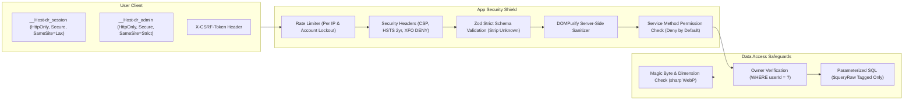

# Devotional Ride — System Architecture (ARCHITECTURE.md)

**Document Version:** 1.0.0  
**Brand:** Devotional Ride  
**Application Architecture:** Next.js (App Router) + TypeScript + Service Layer + Prisma ORM + MySQL 8  
**Infrastructure Target:** Hostinger (Node.js Web App / VPS Ubuntu)  
**Date:** October 2026  

---

## 1. High-Level Architecture & End-to-End Request Flow

The Devotional Ride platform is built as a modular monolith leveraging Next.js App Router for both high-performance Server-Side Rendered (SSR) storefront experiences and secure, strictly validated backend API Route Handlers. All business logic is encapsulated in an isolated service layer (`/src/server/services`) to ensure that API routes remain thin, testable, and completely decoupled from database mechanics.

```mermaid
flowchart TD
    subgraph Clients["Clients"]
        B_Mobile["Mobile Browser (360px+)"]
        B_Desktop["Desktop / Tablet Browser"]
        B_Admin["Admin Browser (Staff Portal)"]
    end

    subgraph HostingerEdge["Hostinger Edge Infrastructure"]
        Edge_SSL["Edge SSL Termination (HTTPS)"]
        Edge_WAF["Cloudflare / Hostinger WAF & DDoS Shield"]
        Edge_Static["Static Asset CDN Cache (/_next/static, /images)"]
    end

    subgraph AppServer["Next.js Server Runtime (Node.js 20/22 LTS)"]
        subgraph Middleware["Global Middleware Layer"]
            MW_Sec["Security Headers (HSTS, CSP, XFO, Sniff)"]
            MW_Rate["Rate Limiter (Redis / MySQL Leaky Bucket)"]
            MW_Auth["Session Cookie Resolver (__Host-session, __Host-admin)"]
            MW_Routing["Domain & Path Router (/api, /admin, (shop))"]
        end

        subgraph Presentation["Presentation & API Routing"]
            App_Store["Storefront Pages (RSC + Client Components)"]
            App_Admin["Admin Panel Pages (/admin/*)"]
            App_API_Pub["Public API Handlers (/api/v1/*)"]
            App_API_Adm["Admin API Handlers (/api/admin/*)"]
            App_Webhook["Webhook Handlers (/api/webhooks/*)"]
            App_Cron["Scheduled Job Triggers (/api/cron/*)"]
        end

        subgraph ServiceLayer["Service & Business Logic Layer (/src/server)"]
            Val["Zod Input / Query / Body Validators"]
            S_Auth["Auth & Session Service (Argon2id, TOTP)"]
            S_Catalog["Catalog & Search Service"]
            S_Inv["Inventory & Reservation Service (15m lock)"]
            S_Cart["Cart & Pricing Service (Paise Engine)"]
            S_Checkout["Checkout & Taxation Service (GST Engine)"]
            S_Order["Order & State Machine Service"]
            S_Audit["Audit Log Service"]
            S_Claims["Warranty & Crash Claims Service"]
            S_Content["CMS, Blog & Settings Service"]
        end

        subgraph IntegrationAdapters["Provider Interfaces & Adapters (/src/lib)"]
            P_Pay["PaymentProvider (RazorpayAdapter / MockRazorpay)"]
            P_Ship["ShippingProvider (ShiprocketAdapter / MockShiprocket)"]
            P_Mail["Mailer (HostingerSMTPAdapter / MockMailer)"]
            P_Storage["StorageDriver (LocalStorage / S3CompatibleStorage)"]
        end
    end

    subgraph DatabaseLayer["Data Persistence Layer"]
        Prisma["Prisma ORM (Connection Pool, Type-Safe Client)"]
        MySQL[("MySQL 8 / MariaDB (InnoDB, utf8mb4)")]
        PrivateStorage[("Private Storage (/storage - Receipts, Claim Images)")]
    end

    subgraph SideChannels["External Services & Gateways"]
        Ext_Razorpay["Razorpay Payment Gateway (UPI, Cards, Netbanking)"]
        Ext_Shiprocket["Shiprocket Logistics Aggregator (AWBs, Tracking)"]
        Ext_HostingerSMTP["Hostinger SMTP Mail Server"]
    end

    %% Client to Edge
    B_Mobile & B_Desktop & B_Admin --> Edge_SSL
    Edge_SSL --> Edge_WAF
    Edge_WAF --> Edge_Static
    Edge_WAF --> Middleware

    %% Middleware to Routing
    MW_Sec --> MW_Rate --> MW_Auth --> MW_Routing
    MW_Routing --> App_Store
    MW_Routing --> App_Admin
    MW_Routing --> App_API_Pub
    MW_Routing --> App_API_Adm
    MW_Routing --> App_Webhook
    MW_Routing --> App_Cron

    %% Handlers to Service Layer
    App_API_Pub & App_API_Adm --> Val
    Val --> ServiceLayer
    App_Store & App_Admin -.-> ServiceLayer

    %% Services to Integrations & DB
    ServiceLayer --> IntegrationAdapters
    ServiceLayer --> Prisma
    Prisma --> MySQL
    IntegrationAdapters --> PrivateStorage

    %% Side Channel Integrations
    P_Pay <--> Ext_Razorpay
    P_Ship <--> Ext_Shiprocket
    P_Mail --> Ext_HostingerSMTP

    %% Inbound Webhooks
    Ext_Razorpay -.->|Signature Verified Webhook| App_Webhook
    Ext_Shiprocket -.->|Status Update Webhook| App_Webhook
```



---

## 2. Comprehensive Modular Architecture

Each functional domain of Devotional Ride is implemented as an encapsulated module with defined entities, service operations, and business invariant rules.

### 2.1 Catalog Module
- **Purpose:** Manages products, multidimensional variants (Color × Size), categories, and curated collections.
- **Key Entities:** `Category`, `Collection`, `Product`, `ProductCategory`, `ProductCollection`, `ProductVariant`, `SizeChart`, `SizeChartRow`.
- **Services:** `CatalogService`, `CategoryService`, `CollectionService`.
- **Business Invariants:**
  - Slugs must be unique, lowercase, and URL-safe.
  - Public URLs expose slugs (`/products/devotional-touring-jacket-mk1`), never sequential integer IDs.
  - Price is stored as integer paise (`pricePaise`, `comparePricePaise`).
  - Active products must have at least one active variant with a valid SKU.
  - Categories support nesting up to 3 tiers with `parentId` relations.

### 2.2 Inventory Module
- **Purpose:** Real-time stock tracking, reservation holds, oversell prevention, and immutable auditing of stock fluctuations.
- **Key Entities:** `Inventory`, `InventoryMovement`.
- **Services:** `InventoryService`.
- **Business Invariants:**
  - High-concurrency conditional decrement:
    ```sql
    UPDATE inventory 
    SET quantity = quantity - ?, reserved = reserved - ? 
    WHERE variantId = ? AND (quantity - reserved) >= ?;
    ```
  - Checkout hold locks stock for **15 minutes**; releases automatically on expiration if not paid.
  - Every single adjustment logs an immutable record in `inventory_movements` tagged with a reason (`sale`, `restock`, `reservation_hold`, `reservation_release`, `return`, `adjustment`) and the responsible actor.

### 2.3 Cart Module
- **Purpose:** Transient shopping cart management across guest visitors and authenticated customers.
- **Key Entities:** `Cart`, `CartItem`.
- **Services:** `CartService`.
- **Business Invariants:**
  - Guest carts are tracked via cryptographically signed `httpOnly` cookie (`dr_guest_token`).
  - Upon user sign-in or account registration, the guest cart is merged into the customer's permanent cart, deduplicating identical variants and capping at available inventory.
  - Price snapshots (`priceSnapshotPaise`) are captured when adding items to detect price alterations before checkout.

### 2.4 Checkout Module
- **Purpose:** Pincode validation, order calculation quote generation, address capture, and double-submit prevention.
- **Key Entities:** `Address`, `OrderQuote` (ephemeral).
- **Services:** `CheckoutService`, `TaxationService`.
- **Business Invariants:**
  - Server recalculates all subtotals, active discounts, GST splits, and delivery rates. Never accepts client-side prices.
  - Auto-resolves City and State from 6-digit Indian Pincode.
  - Validates Shiprocket courier delivery serviceability and COD eligibility.
  - Client sends an idempotency token (`checkout_idempotency_key`) to eliminate double charges on rapid clicks.

### 2.5 Orders Module
- **Purpose:** Lifecycle management of customer orders, status transitions, and purchase timelines.
- **Key Entities:** `Order`, `OrderItem`, `OrderEvent`.
- **Services:** `OrderService`.
- **Business Invariants:**
  - Finite State Machine:
    $$\text{pending\_payment} \longrightarrow \text{paid} \longrightarrow \text{processing} \longrightarrow \text{shipped} \longrightarrow \text{delivered}$$
    *Branching States:* $\text{cancelled}$, $\text{returned}$, $\text{refunded}$.
  - Invalid transitions reject with a `400 Bad Request`.
  - Every state transition appends an immutable timeline row in `order_events` with actor type (`system`, `customer`, `admin`) and explanatory notes.
  - `OrderItem` captures a point-in-time snapshot of the product title, SKU, variant attributes, price, and GST rate.

### 2.6 Payments Module
- **Purpose:** Orchestration of Razorpay digital payments, webhook validation, and Cash on Delivery rules.
- **Key Entities:** `Payment`, `Refund`, `WebhookEvent`.
- **Services:** `PaymentService`, `RazorpayAdapter`.
- **Business Invariants:**
  - Never marks an order as `paid` from a browser client redirect. Orders are marked paid solely via server-side verification:
    $$\text{HMAC-SHA256}(\text{order\_id} + "|" + \text{payment\_id}, \text{secret}) == \text{signature}$$
    evaluated with constant-time string comparison (`crypto.timingSafeEqual`).
  - Webhooks verify `X-Razorpay-Signature` against raw body payload and record `eventId` for strict idempotency.
  - Zero raw credit card or CVV details pass through or touch the Devotional Ride server (maintains strict PCI-DSS SAQ A status).
  - COD order limit enforced against configurable store maximum (e.g., ₹10,000 ceiling).

### 2.7 Shipping & Fulfillment Module
- **Purpose:** Logistics dispatch, Shiprocket courier integration, AWB generation, and tracking status synchronization.
- **Key Entities:** `Shipment`, `Order`.
- **Services:** `ShippingService`, `ShiprocketAdapter`.
- **Business Invariants:**
  - Admin creates shipment $\rightarrow$ adapter requests AWB from Shiprocket API.
  - AWB, courier partner name, and tracking URL stored on `Shipment`.
  - Inbound Shiprocket webhooks or periodic pollers advance shipment status (`shipped`, `in_transit`, `out_for_delivery`, `delivered`, `rto`).

### 2.8 Customers Module
- **Purpose:** Customer accounts, address book, password security, and DPDP Act 2023 privacy management.
- **Key Entities:** `User`, `Address`, `Session`.
- **Services:** `CustomerService`, `PrivacyService`.
- **Business Invariants:**
  - Passwords hashed using `argon2id` (64 MB memory, 3 iterations, 1 parallelism).
  - Enforces minimum 10-character password policy checked against common leaked passwords.
  - IDOR protection: every query for customer orders, addresses, or profile data strictly enforces:
    $$\text{WHERE } id = ? \text{ AND } userId = ?$$
  - Provides customer data export (JSON/CSV) and automated deletion workflow to comply with Indian data protection legislation.

### 2.9 Reviews Module
- **Purpose:** Community social proof with ratings, write-ups, and user-uploaded gear photos.
- **Key Entities:** `Review`, `Media`.
- **Services:** `ReviewService`.
- **Business Invariants:**
  - Only customers who purchased the specific product variant and have a status of `delivered` can submit a review.
  - Submissions enter a `pending` moderation state; published only after an Admin approves them.
  - Customer review photos are scanned, sanitized, converted to WebP via `sharp`, and hosted safely.

### 2.10 Wishlist Module
- **Purpose:** Persistent cross-device bookmarking of desired riding gear.
- **Key Entities:** `Wishlist`.
- **Services:** `WishlistService`.
- **Business Invariants:**
  - Unique composite index on `(userId, productId)`.
  - Accessible only to authenticated customers; optimistic UI toggle on storefront cards.

### 2.11 Coupons Module
- **Purpose:** Marketing discount codes, promotional offers, and cart-level incentives.
- **Key Entities:** `Coupon`, `CouponRedemption`.
- **Services:** `CouponService`.
- **Business Invariants:**
  - Discount types: `percentage` or `fixed_amount_paise`.
  - Enforces start date, expiration date, minimum cart order value, overall maximum usage limit, and per-user usage limits inside the database order transaction.

### 2.12 Back-in-Stock Alerts Module
- **Purpose:** Customer re-engagement for sold-out sizes/colors.
- **Key Entities:** `StockAlert`.
- **Services:** `AlertService`.
- **Business Invariants:**
  - Unique index on `(variantId, email)` where `notifiedAt IS NULL`.
  - Automatically triggers transactional emails via Hostinger SMTP when variant inventory goes from 0 to $>0$.

### 2.13 Store & Dealer Locator Module
- **Purpose:** Interactive search directory of authorized physical dealers, exclusive touchpoints, and service outlets.
- **Key Entities:** `Store`.
- **Services:** `StoreService`.
- **Business Invariants:**
  - Classified by category: `exclusive`, `authorized_dealer`, `online_partner`, `international`.
  - Stores latitude, longitude, address, phone number, operating hours, and Google Maps direct URL.
  - Fast proximity and city/state filtering for mobile riders on the road.

### 2.14 Warranty Registration Module
- **Purpose:** Digital registration of motorcycle gear coverage (jackets, pants, helmets, luggage).
- **Key Entities:** `WarrantyRegistration`.
- **Services:** `WarrantyService`.
- **Business Invariants:**
  - Allows registration of purchases made both directly online (auto-linked via order number) and offline through authorized dealers (via invoice receipt image upload).
  - Validates purchase date against product warranty coverage windows (e.g., 2 to 5 years).

### 2.15 Crash-Replacement Claims Module
- **Purpose:** Rider protection program offering subsidised replacement gear following road accidents.
- **Key Entities:** `CrashClaim`, `WarrantyRegistration`.
- **Services:** `CrashClaimService`.
- **Business Invariants:**
  - Structured claim workflow:
    $$\text{new} \longrightarrow \text{in\_review} \longrightarrow \text{approved / rejected} \longrightarrow \text{resolved}$$
  - Captures incident date, detailed crash narration, and uploaded photographs of the damaged gear.
  - Admin review generates private notes and automated notification emails to the rider with replacement voucher codes upon approval.

### 2.16 Enquiries & Dealer Leads Module
- **Purpose:** Inbound lead pipeline for prospective Indian and international business partners and general rider inquiries.
- **Key Entities:** `DealerLead`, `Enquiry`.
- **Services:** `LeadService`.
- **Business Invariants:**
  - Captures business name, contact information, GSTIN, dealership location, and floor area.
  - Protected by Cloudflare Turnstile / Google reCAPTCHA v3 and IP rate limiting (5 submissions/hour/IP) to prevent spam.
  - Admin inbox provides status tracking (`new`, `contacted`, `qualified`, `rejected`) and assigned staff tracking.

### 2.17 Blog & CMS Pages Module
- **Purpose:** Content marketing engine for tour guides, technical gear care, CE safety education, and statutory policies.
- **Key Entities:** `BlogPost`, `Page`.
- **Services:** `ContentService`.
- **Business Invariants:**
  - All rich HTML content is sanitized server-side with `isomorphic-dompurify` prior to database persistence and prior to rendering.
  - Includes dedicated SEO fields (`seoTitle`, `seoDescription`, OpenGraph image).
  - Pre-seeded with essential policies: Privacy Policy, Terms & Conditions, Shipping & Delivery, Returns & Refunds, Wash & Care, CE Declaration of Conformity.

### 2.18 Banners Module
- **Purpose:** Homepage visual merchandise displays, seasonal campaigns (e.g., "Monsoon Touring"), and announcement bar strips.
- **Key Entities:** `Banner`.
- **Services:** `BannerService`.
- **Business Invariants:**
  - Supports responsive image pairs (`imageDesktopId`, `imageMobileId`) to ensure zero layout shift and minimal payload on smartphones.
  - Date scheduling (`startsAt`, `endsAt`) enables time-bound marketing launches.

### 2.19 SEO Module
- **Purpose:** Maximum search visibility across Google and search engines for riding gear queries.
- **Services:** `SeoService`.
- **Specifications:**
  - Dynamic `sitemap.xml` generation for products, categories, collections, and blog posts.
  - Configurable `robots.txt` blocking `/admin`, `/api`, `/checkout`, `/account`, and `/cart`.
  - Rich JSON-LD structured data: `Product` (with real-time price & aggregate rating), `BreadcrumbList`, `Organization`, `Article`, and `FAQPage`.
  - Canonical URLs on every public route to prevent duplicate content indexing.

### 2.20 Notifications Module
- **Purpose:** Transactional email and administrative notification dispatcher.
- **Key Entities:** `NotificationQueue`, `NotificationTemplate`.
- **Services:** `NotificationService`, `NodemailerAdapter`.
- **Business Invariants:**
  - Checkout and critical user paths never block synchronously on SMTP network calls.
  - Emails are written to an internal queue table and processed asynchronously via background scheduler.
  - Responsive, high-contrast HTML templates matching Devotional Ride's dark/accent aesthetic.

### 2.21 Audit Log Module
- **Purpose:** Regulatory compliance, forensic visibility, and internal operational accountability.
- **Key Entities:** `AuditLog`.
- **Services:** `AuditService`.
- **Business Invariants:**
  - Immutable append-only ledger: no user or admin can modify or delete audit log entries.
  - Records actor ID, actor role, IP address, user-agent, target entity, entity ID, action (`create`, `update`, `delete`), and JSON snapshots of `before` and `after` states.

### 2.22 Admin Users and Roles Module
- **Purpose:** Secure administrative access control for company staff.
- **Key Entities:** `AdminUser`, `Role`, `Permission`, `RolePermission`, `AdminSession`.
- **Services:** `AdminAuthService`.
- **Business Invariants:**
  - Separate authentication realm from customer accounts; uses distinct session cookies (`__Host-dr_admin_session`, `SameSite=Strict`).
  - Mandatory Time-based One-Time Password (TOTP) 2FA using authenticator apps. 8 single-use recovery codes generated on onboarding.
  - TOTP secrets encrypted at rest in the database using AES-256-GCM.
  - Idle session expiration after 30 minutes; absolute timeout after 8 hours.
  - Re-authentication with password required prior to processing refunds, modifying staff roles, or changing payment keys.

### 2.23 Settings Module
- **Purpose:** Global dynamic store parameters without requiring code deployments.
- **Key Entities:** `Setting`.
- **Services:** `SettingsService`.
- **Parameters:** Store name, Indian registered business address, GSTIN, HSN classification defaults, free shipping cart threshold (e.g., ₹1,999), COD limits, COD extra fee, maintenance mode toggle.

---

## 3. Comprehensive Route Map

### 3.1 Public Storefront Pages (Next.js App Router)
```
/                                   -> Home (Hero slider, Curated collections, Trust strip)
/collections/[slug]                 -> Collection page (Product grid, filter drawer, sort)
/products/[slug]                    -> Product detail (Gallery, color/size matrix, size chart, reviews)
/search                             -> Live search query results
/cart                               -> Shopping cart page
/checkout                           -> Step-by-step checkout (Address, Pincode check, Payment)
/orders/[number]                    -> Order confirmation & real-time tracking timeline
/track-order                        -> Public order status lookup (Order # + Email/Phone)
/stores                             -> Store and dealer locator with interactive map
/dealer-india                       -> Domestic dealer partner application form
/dealer-international               -> International distributor inquiry form
/warranty                           -> Warranty registration submission portal
/crash-replacement                  -> Crash-replacement claim submission form
/contact                            -> Customer inquiry & support form
/blog                               -> Technical gear and touring articles list
/blog/[slug]                        -> Single blog post with Table of Contents & JSON-LD
/pages/[slug]                       -> Static CMS legal pages (Terms, Privacy, Wash & Care, CE)
/account/login                      -> Customer login
/account/register                   -> Customer registration
/account/forgot-password            -> Password reset request
/account/reset-password             -> Password reset submission
/account/profile                    -> Manage profile and saved addresses
/account/orders                     -> Customer order history & invoice downloads
/account/wishlist                   -> Saved wishlist items
/account/claims                     -> Customer warranty and crash claim statuses
/design                             -> Design system component showroom (Development only)
```

### 3.2 Public API Endpoints (`/api/v1/...`)
```
GET    /api/v1/products             -> Filtered product catalog with cursor pagination
GET    /api/v1/products/:slug       -> Detailed product information with variants & stock
GET    /api/v1/collections          -> Active collections list
GET    /api/v1/collections/:slug    -> Collection details & assigned products
GET    /api/v1/search               -> Autocomplete search query & suggestions
GET    /api/v1/cart                 -> Retrieve current active cart
POST   /api/v1/cart                 -> Add item variant to cart
PATCH  /api/v1/cart                 -> Update line item quantity
DELETE /api/v1/cart                 -> Remove line item
POST   /api/v1/checkout/quote       -> Authoritative server pricing, GST & shipping quote
POST   /api/v1/checkout/pincode     -> Shiprocket serviceability & COD verification
POST   /api/v1/checkout/place       -> Initiate order & reserve inventory
POST   /api/v1/payments/razorpay/create -> Create Razorpay order ID
POST   /api/v1/payments/razorpay/verify -> Verify payment signature & mark paid
GET    /api/v1/orders/track         -> Query public order tracking status
POST   /api/v1/auth/register        -> Create customer account
POST   /api/v1/auth/login           -> Customer authentication & session issuance
POST   /api/v1/auth/logout          -> Invalidate customer session
POST   /api/v1/auth/forgot-password -> Request password reset email
POST   /api/v1/auth/reset-password  -> Execute password reset
GET    /api/v1/me                   -> Retrieve current authenticated profile
GET    /api/v1/me/orders            -> Retrieve customer order history
GET    /api/v1/me/orders/:id/invoice -> Download GST tax invoice PDF
POST   /api/v1/me/orders/:id/return -> Request return for delivered item
GET    /api/v1/me/addresses         -> List saved addresses
POST   /api/v1/me/addresses         -> Create saved address
PUT    /api/v1/me/addresses/:id     -> Update saved address
DELETE /api/v1/me/addresses/:id     -> Delete saved address
GET    /api/v1/me/wishlist          -> List customer wishlist
POST   /api/v1/me/wishlist          -> Add product to wishlist
DELETE /api/v1/me/wishlist/:id      -> Remove product from wishlist
POST   /api/v1/products/:id/reviews -> Submit verified-purchaser review
POST   /api/v1/forms/dealer         -> Submit dealer inquiry (Captcha protected)
POST   /api/v1/forms/warranty       -> Submit warranty registration
POST   /api/v1/forms/crash-claim    -> Submit crash-replacement claim (with photos)
POST   /api/v1/forms/enquiry        -> Submit contact form
POST   /api/v1/forms/stock-alert    -> Subscribe to restock notification
GET    /api/v1/stores               -> Fetch dealer and store locator directory
GET    /api/v1/blog                 -> List published articles
GET    /api/v1/blog/:slug           -> Read published article
GET    /api/v1/pages/:slug          -> Read static CMS page
GET    /api/v1/banners              -> Active promotional banners
```

### 3.3 Admin Panel Pages (`/admin/...`)
```
/admin/login                        -> Staff login & TOTP 2FA verification
/admin                              -> Executive dashboard (Revenue, Orders, Low Stock, Claims)
/admin/products                     -> Product inventory & variant matrix management
/admin/products/new                 -> Product creation wizard
/admin/products/:id                 -> Product editor (Variants, Images, Size charts, SEO)
/admin/categories                   -> Category tree manager with drag-and-drop
/admin/collections                  -> Curated and rule-based collection builder
/admin/inventory                    -> Stock ledger, manual adjustments & restock ETAs
/admin/orders                       -> Order list with multi-parameter filtering
/admin/orders/:id                   -> Order detail, AWB generation, invoices, refunds
/admin/returns                      -> Return requests & refund approval queue
/admin/customers                    -> Customer directory & account management
/admin/reviews                      -> Review moderation queue (Approve / Reject)
/admin/claims/warranty              -> Warranty registration review & validation
/admin/claims/crash                 -> Crash-replacement claim processing & voucher issuer
/admin/leads                        -> B2B dealer inquiries & lead status workflow
/admin/enquiries                    -> Customer support inquiries & response templates
/admin/marketing/coupons            -> Coupon code generator & usage limits
/admin/marketing/banners            -> Hero sliders & announcement bar scheduling
/admin/content/blog                 -> Blog article editor with sanitized HTML
/admin/content/pages                -> CMS legal & brand pages editor
/admin/settings                     -> Store profile, GST rules, shipping thresholds, API keys
/admin/staff                        -> Staff accounts, role assignments, 2FA resets
/admin/audit-logs                   -> System-wide audit log inspector
```

### 3.4 Admin API Endpoints (`/api/admin/...`)
```
POST   /api/admin/auth/login        -> Admin authentication & 2FA validation
POST   /api/admin/auth/logout       -> Invalidate admin session
GET    /api/admin/dashboard         -> Analytics metrics & pending task queues
GET    /api/admin/products          -> Paginated product list
POST   /api/admin/products          -> Create product & variant matrix
PUT    /api/admin/products/:id      -> Update product & variants
DELETE /api/admin/products/:id      -> Soft-delete product
POST   /api/admin/inventory/adjust  -> Stock quantity adjustment with audit note
GET    /api/admin/orders            -> Filterable orders list
GET    /api/admin/orders/:id        -> Order details
POST   /api/admin/orders/:id/fulfill -> Generate Shiprocket shipment & AWB
POST   /api/admin/orders/:id/refund -> Process Razorpay partial/full refund
POST   /api/admin/orders/:id/note   -> Append internal administrative order note
GET    /api/admin/reviews           -> Pending reviews queue
PATCH  /api/admin/reviews/:id       -> Approve / Reject review
GET    /api/admin/claims/crash      -> Crash claims list
PATCH  /api/admin/claims/crash/:id  -> Update crash claim status & issue discount
GET    /api/admin/leads             -> Dealer leads list
PATCH  /api/admin/leads/:id         -> Update lead status & assign team member
GET    /api/admin/audit-logs        -> Query structured audit log records
GET    /api/admin/settings          -> Read store configuration settings
PUT    /api/admin/settings          -> Update store configuration settings
POST   /api/admin/media/upload      -> Upload image/PDF (sharp WebP conversion)
```

### 3.5 Webhook & Cron Side Channels
```
POST   /api/webhooks/razorpay       -> Razorpay event receiver (HMAC verified)
POST   /api/webhooks/shiprocket     -> Shiprocket tracking update receiver
GET    /api/cron/release-holds      -> Release expired 15-minute inventory holds
GET    /api/cron/abandoned-carts    -> Queue abandoned cart reminders (1h, 24h)
GET    /api/cron/process-emails     -> Asynchronously process notification email queue
GET    /api/cron/cleanup-sessions   -> Purge revoked and expired sessions
GET    /api/health                  -> Healthcheck route (database active check)
```

---

## 4. Entity-Relationship (ER) Overview

```mermaid
erDiagram
    USERS ||--o{ ORDERS : places
    USERS ||--o{ ADDRESSES : owns
    USERS ||--o{ SESSIONS : maintains
    USERS ||--o{ WISHLISTS : saves
    USERS ||--o{ REVIEWS : writes
    USERS ||--o{ WARRANTY_REGISTRATIONS : registers

    ADMIN_USERS }|--|| ROLES : has
    ROLES ||--o{ ROLE_PERMISSIONS : contains
    PERMISSIONS ||--o{ ROLE_PERMISSIONS : mapped

    CATEGORIES ||--o{ CATEGORIES : parent_child
    CATEGORIES ||--o{ PRODUCT_CATEGORIES : classifies
    PRODUCTS ||--o{ PRODUCT_CATEGORIES : contains

    COLLECTIONS ||--o{ PRODUCT_COLLECTIONS : includes
    PRODUCTS ||--o{ PRODUCT_COLLECTIONS : member_of

    PRODUCTS ||--|{ PRODUCT_VARIANTS : has
    PRODUCT_VARIANTS ||--|| INVENTORY : tracks
    PRODUCT_VARIANTS ||--o{ INVENTORY_MOVEMENTS : logs
    PRODUCT_VARIANTS ||--o{ ORDER_ITEMS : purchased_in
    PRODUCT_VARIANTS ||--o{ STOCK_ALERTS : alerts

    PRODUCTS ||--o{ MEDIA : displays
    PRODUCTS ||--o{ SIZE_CHARTS : sizes
    SIZE_CHARTS ||--|{ SIZE_CHART_ROWS : defines

    CARTS ||--o{ CART_ITEMS : holds
    PRODUCT_VARIANTS ||--o{ CART_ITEMS : referenced_in

    ORDERS ||--|{ ORDER_ITEMS : contains
    ORDERS ||--|{ ORDER_EVENTS : timeline
    ORDERS ||--o{ PAYMENTS : paid_by
    ORDERS ||--o{ SHIPMENTS : fulfilled_by
    ORDERS ||--o{ RETURNS : returned_in
    PAYMENTS ||--o{ REFUNDS : refunded_by

    COUPONS ||--o{ COUPON_REDEMPTIONS : used_in
    ORDERS ||--o{ COUPON_REDEMPTIONS : applies

    WARRANTY_REGISTRATIONS ||--o{ CRASH_CLAIMS : claims_under

    USERS {
        string id PK
        string email UK
        string phone
        string passwordHash
        string name
        datetime emailVerifiedAt
        int failedLogins
        datetime lockedUntil
        datetime createdAt
    }

    ADMIN_USERS {
        string id PK
        string email UK
        string passwordHash
        string name
        string roleId FK
        string totpSecret
        boolean totpEnabled
        boolean isActive
    }

    PRODUCTS {
        string id PK
        string name
        string slug UK
        string description
        json highlights
        string material
        string gearType
        string ceClass
        string brandSeries
        string status
        int gstRate
        string hsnCode
        datetime createdAt
    }

    PRODUCT_VARIANTS {
        string id PK
        string productId FK
        string sku UK
        string color
        string size
        int pricePaise
        int comparePricePaise
        int weightGrams
        boolean isActive
    }

    INVENTORY {
        string variantId PK,FK
        int quantity
        int reserved
        int lowStockThreshold
        datetime restockEta
    }

    ORDERS {
        string id PK
        string orderNumber UK
        string userId FK
        string email
        string phone
        string status
        string paymentStatus
        string paymentMethod
        int subtotalPaise
        int discountPaise
        int shippingPaise
        int gstPaise
        int totalPaise
        json shippingAddress
        json billingAddress
        datetime placedAt
    }

    ORDER_ITEMS {
        string id PK
        string orderId FK
        string variantId FK
        string name
        string sku
        int qty
        int unitPricePaise
        int gstPaise
    }

    PAYMENTS {
        string id PK
        string orderId FK
        string provider
        string providerOrderId
        string providerPaymentId
        int amountPaise
        string status
        datetime verifiedAt
    }

    SHIPMENTS {
        string id PK
        string orderId FK
        string courier
        string awb
        string trackingUrl
        string status
        datetime shippedAt
        datetime deliveredAt
    }

    CRASH_CLAIMS {
        string id PK
        string claimNumber UK
        string warrantyId FK
        datetime incidentDate
        string description
        json photos
        string status
        string resolution
    }

    AUDIT_LOGS {
        string id PK
        string actor
        string action
        string entity
        string entityId
        json before
        json after
        string ip
        datetime createdAt
    }
```



---

## 5. Security & Isolation Architecture



### 5.1 Defense-in-Depth Mechanisms:
1. **Cookie Prefixing (`__Host-`):** Session cookies use `__Host-` prefix ensuring they can only be sent from the exact origin over HTTPS with no subdomain inheritance.
2. **Strict Content Security Policy (CSP):**
   ```
   default-src 'self';
   script-src 'self' 'nonce-{RANDOM}' https://checkout.razorpay.com https://www.googletagmanager.com;
   frame-src https://api.razorpay.com;
   img-src 'self' data: blob: https:;
   connect-src 'self' https://lumberjack.razorpay.com https://www.google-analytics.com;
   object-src 'none';
   base-uri 'self';
   form-action 'self';
   frame-ancestors 'none';
   ```
3. **Admin Two-Factor Authentication:** TOTP authentication is mandatory for staff access; TOTP secrets are encrypted with AES-256-GCM using keys stored outside the database.
4. **IDOR & Authorization at Service Boundary:** Authentication and authorization are not merely checked at route boundaries; every service method enforces explicit tenant ownership and role permission keys (e.g., `order.refund`, `product.write`).

---

## 6. Assumptions & Architectural Open Questions

### 6.1 System Assumptions
1. **Server Architecture:** The backend service layer and frontend React components reside in the same repository deployed to Hostinger as a unified Next.js application, eliminating multi-service latency.
2. **Database:** Hostinger MySQL 8 with an InnoDB storage engine configured with `utf8mb4_unicode_ci` for international character support.
3. **Image Handling:** Production images are converted to WebP via `sharp` and stored outside the public document root in `/storage`, served via an authenticated streaming route. Migration to S3/Cloudflare R2 is abstracted behind `StorageDriver`.

### 6.2 Architectural Open Questions
1. **Cache Layer for Rate Limiting:** In a multi-worker Hostinger Node.js or VPS environment, should rate limiting use a lightweight MySQL table or an in-memory/Redis instance? *(Recommendation: Use MySQL table with memory cleanup for zero extra infrastructure cost on Hostinger).*
2. **Background Jobs / Crons:** Hostinger shared/business plans lack always-on daemon threads. Should cron tasks be executed via Hostinger cPanel scheduled curl pings to `/api/cron/*` protected by `CRON_SECRET`? *(Recommendation: Yes, standard practice for Hostinger).*

---

## 7. Approval & Next Steps

With `ARCHITECTURE.md` and `REQUIREMENTS.md` established, Phase 1 is complete. Upon review and approval, development will immediately commence on **Phase 2: Design System & Visual Style**, establishing the Tailwind token theme and the `/design` preview showcase.

